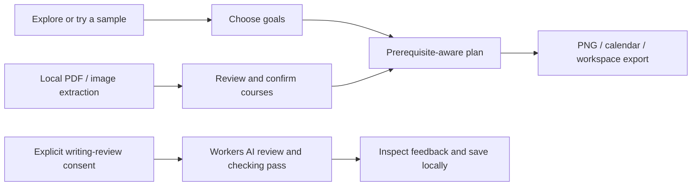
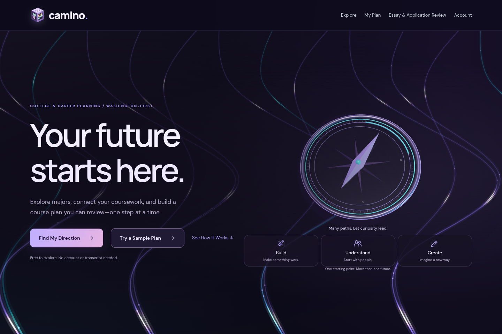
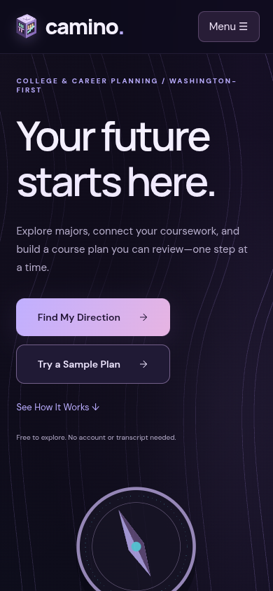

# Camino

**College and career planning, one step at a time.**

[Try Camino](https://camino-your-direction.yourdirection.workers.dev/) · [Open the sample plan](https://camino-your-direction.yourdirection.workers.dev/#preview) · [Project write-up](docs/LINKEDIN-PROJECT.md)


Camino is a Washington-first student planning application. It connects interactive major exploration, reviewed coursework and prerequisite-aware course plans in a responsive web experience. Visitors can try a sample plan without an account or transcript.

## What it does

- **Explore:** an animated Three.js forest quiz, a searchable program catalog and on-page career/salary exploration.
- **Import:** local PDF text extraction and image OCR, with a review step for course credits, grades and originating institutions.
- **Plan:** prerequisite-aware scheduling, per-course school alternatives where documented, workload comparisons, checkpoints, PNG and calendar exports.
- **Review writing:** a separate, consent-based essay/application review workspace with quote-matched evidence and optional-versus-prompt-related feedback. AI feedback remains fallible and should be checked against the original prompt.
- **Keep control:** browser-local workspaces, explicit backups/restores and a data-reset control. No ChatGPT login is needed on the live deployment.

## Engineering

The frontend uses JavaScript, HTML and CSS with self-hosted Three.js, PDF.js and Tesseract.js. Cloudflare Workers serves the application and optional Workers AI review API. GitHub validation and Cloudflare Workers Builds deploy changes from `main`.

Transcripts are processed on the device and require confirmation before they become coursework. The planner uses prerequisite graphs, credit/course-count limits, bounded search for small schedules and a heuristic for larger plans. Writing review uses structured model output, a separate checking pass, literal/whitespace quote matching, conservative unknown states and cancellation/stale-response guards. Two passes using one model are not independent validation.



## Run and validate

Use Node.js 22 or newer and npm.

```sh
npm ci
npm run validate
python3 -m http.server 8080 --directory dist
```

Open `http://localhost:8080`. Static local preview supports the interface and browser-local planning; the writing API and live source reader require a Worker deployment. See [HOSTING.md](HOSTING.md) for Cloudflare setup. The production entry point is `worker/standalone.mjs`, configured by `wrangler.jsonc`.

Validation includes scheduling/import/evidence regressions, full-app DOM tests and browser acceptance checks with synthetic data. Live reviewer checks are explicitly gated; ordinary CI does not send writing to an AI service. See [CHECKLIST.md](CHECKLIST.md) and the release notes for completed work and current limits.

## Scope and privacy

The program catalog is broader than the structured planning models. This is a planning aid, not a complete degree audit for every listed program, an admissions probability model, or a guarantee of transfer credit or graduation. Source applicability and future course availability need confirmation.

The standalone Worker has no account database or raw-document upload endpoint. Coursework and saved workspaces live in the browser. Optional AI review sends the text and any coursework the student explicitly selects to Cloudflare Workers AI; feedback is fallible. The separate legacy Sites account adapter remains in the repository but is not the live deployment's authentication or storage system.

Synthetic fixtures are used for regression tests. Do not commit student documents, names, IDs, API tokens or other private information.

<details>
<summary>Desktop and mobile screenshots</summary>





</details>
